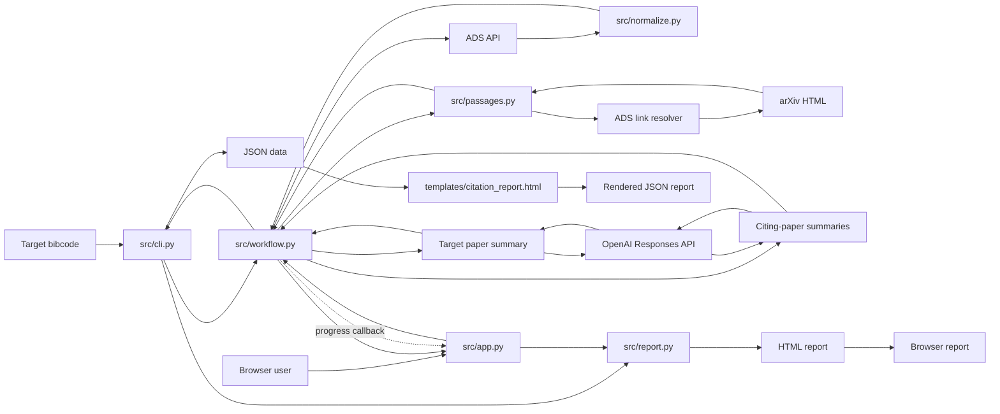

# Pipeline overview

The CLI and local browser app turn a target ADS bibcode into an HTML report
about the target paper and papers that cite it.



## Main steps

1. **Read the input** — [`src/cli.py`](src/cli.py) accepts a target bibcode and
   optional `--rows` limit (default: 10). The local browser app in
   [`src/app.py`](src/app.py) accepts the same inputs through a form. Both call
   the workflow. The CLI saves HTML and JSON files under `citation_reports/`;
   the browser app serves the current report from memory.
2. **Retrieve and normalize the target** — [`src/workflow.py`](src/workflow.py)
   gets the target paper from ADS through [`src/ads.py`](src/ads.py) and
   converts it to a consistent record with [`src/normalize.py`](src/normalize.py).
   If ADS has no target record, the workflow stops with an error.
3. **Summarize the target paper** — [`src/summarize.py`](src/summarize.py)
   summarizes the target's ADS title and abstract once. The result and
   generation metadata are passed to the report. If ADS has no abstract, the
   report says “No abstract available” and no OpenAI request is made for it.
4. **Find citation passages** — The workflow retrieves citing papers from ADS.
   For each one,
   [`src/passages.py`](src/passages.py) uses the ADS link resolver to find its
   arXiv HTML, then connects in-text links to individual bibliography entries.
   It matches the target by bibcode or DOI, then by a unique normalized title,
   then by a unique first-author/year pair. For each passage, it records the
   visible text of links to the matched target reference. If the resolver or
   arXiv HTML is unavailable (HTTP 404 or 403), the paper has no extracted
   passages; network errors otherwise stop the workflow.
5. **Summarize citation use** — When passages are available,
   [`src/workflow.py`](src/workflow.py) sends the target identity, citing-paper
   identity, and extracted passages to [`src/summarize.py`](src/summarize.py),
   which calls the OpenAI API. The passages provide evidence for the summary.
   If none are available, the workflow returns a fixed “not enough context”
   message and skips the OpenAI request for that citing paper.
6. **Render the report** — [`src/report.py`](src/report.py) creates a
   standalone HTML page with the target summary and a card for each citing
   paper, including its normalized record, passages, and summary. MathJax loads
   from a CDN to render math; without an internet connection, the original TeX
   notation remains readable. The report highlights the target-linked citation
   text within each passage. The JSON includes that text in the
   `target_citation_labels` field so the generic viewer can highlight it too.
   Generation details are available in collapsed sections. The CLI also saves
   the complete workflow results as JSON for use by other tools. Both files
   share the basename
   `citation_report_<encoded-bibcode>` and use `.html` and `.json` extensions;
   their locations are printed. The browser app uses the same renderer and
   serves the completed report at `/report`.
7. **View a saved JSON report** — `templates/citation_report.html` renders a
   selected JSON file with its file picker. When served locally, it can also
   fetch the JSON by bibcode from `citation_reports/`.

## Run

From the project root, set `ADS_API_TOKEN` and `OPENAI_API_KEY`. To use the
CLI, run:

```sh
python3.12 -m src.cli "TARGET_BIBCODE"
```

To use the local browser app, run:

```sh
python3.12 -m src.app
```

Then open `http://127.0.0.1:8000`. The app shows workflow progress and a link
to the completed HTML report. Its result is kept in memory until another run
starts or the app stops.
