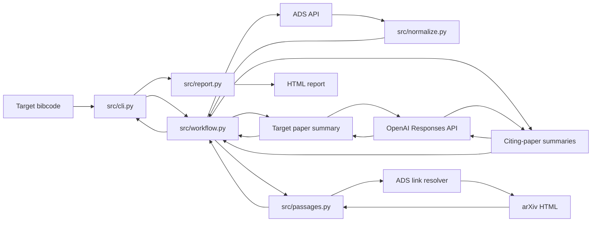

# Pipeline overview

The CLI turns a target ADS bibcode into an HTML report about the target paper
and papers that cite it.



## Main steps

1. **Read the input** — [`src/cli.py`](src/cli.py) accepts a target bibcode and
   optional `--rows` limit (default: 10). It calls the workflow and writes the
   report under `citation_reports/` in the current working directory, creating
   the folder if needed.
2. **Retrieve and normalize the target** — [`src/workflow.py`](src/workflow.py)
   gets the target paper from ADS through [`src/ads.py`](src/ads.py) and
   converts it to a consistent record with [`src/normalize.py`](src/normalize.py).
   If ADS has no target record, the workflow stops with an error.
3. **Summarize the target paper** — [`src/summarize.py`](src/summarize.py)
   summarizes the target's ADS title and abstract once. The result and
   generation metadata are passed to the report. If ADS has no abstract, the
   report says “No abstract available” and no OpenAI request is made for it.
4. **Find citation passages** — The workflow retrieves citing papers from ADS.
   For each one,
   [`src/passages.py`](src/passages.py) uses the ADS link resolver to find its
   arXiv HTML, then connects in-text links to individual bibliography entries.
   It matches the target by bibcode or DOI, then by a unique normalized title,
   then by a unique first-author/year pair. If the resolver or arXiv HTML is
   unavailable (HTTP 404 or 403), the paper has no extracted passages; network
   errors otherwise stop the workflow.
5. **Summarize citation use** — For each citing paper,
   [`src/summarize.py`](src/summarize.py) sends the target identity, citing-paper
   identity, and extracted passages to the OpenAI API. The passages provide
   evidence for the summary. When none are found, the summary has no passage
   context to use.
6. **Render the report** — [`src/report.py`](src/report.py) creates a
   self-contained HTML page with the target summary and a card for each citing
   paper, including its normalized record, passages, and summary. Generation
   details are available in collapsed sections. The CLI saves the file as
   `citation_reports/citation_report_<encoded-bibcode>.html` and prints its
   location.

## Run

From the project root, set `ADS_API_TOKEN` and `OPENAI_API_KEY`, then run:

```sh
python3.12 -m src.cli "TARGET_BIBCODE"
```
